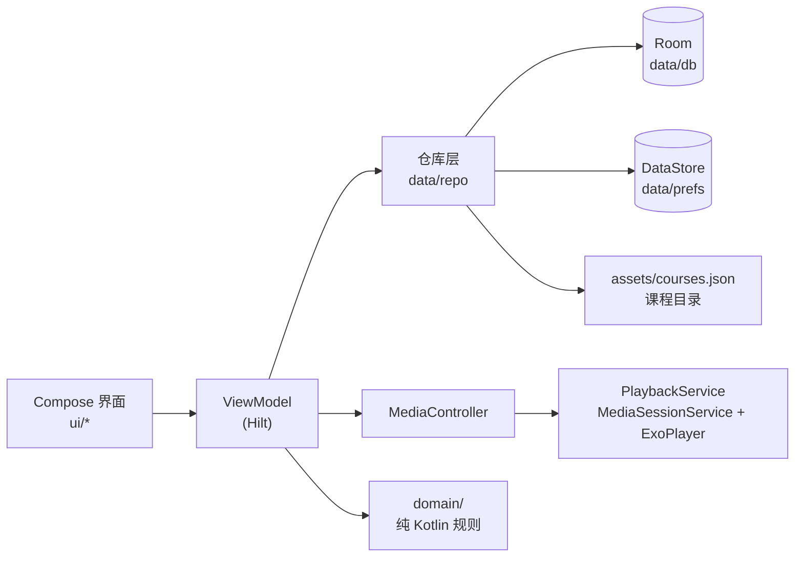

<h1 align="center">无限学堂 · Infinite Learn</h1>

<p align="center">
  一款原生 Android 课程学习应用，体验接近主流在线课程平台：分类浏览、收藏与购买、课时播放、进度记录、带时间戳的笔记与成就。
</p>

<p align="center">
  <a href="https://github.com/OWNER/REPO/actions/workflows/android.yml"></a>
  <a href="LICENSE"></a>
  
  
  
  
</p>

> **说明**：应用内的课程、讲师、评论、价格和视频均为**占位内容**，用于演示完整的学习流程。购买流程为模拟流程，不接入任何支付渠道，不会产生真实扣款。

---

## 目录

- [功能概览](#功能概览)
- [截图](#截图)
- [快速开始](#快速开始)
- [技术栈](#技术栈)
- [架构简述](#架构简述)
- [项目结构](#项目结构)
- [添加你自己的课程](#添加你自己的课程)
- [版本与更新记录](#版本与更新记录)
- [路线图](#路线图)
- [常见问题](#常见问题)
- [贡献](#贡献)
- [许可与致谢](#许可与致谢)

## 功能概览

| 模块 | 功能 |
|------|------|
| **账号** | 本地注册、登录、退出；密码以 PBKDF2-HMAC-SHA256 哈希保存；多账号数据互相独立 |
| **首页** | 自动轮播的精选横幅、分类快捷入口、"继续学习"、精选推荐、全部课程 |
| **分类与搜索** | 按分类浏览；按课程名或讲师搜索，可按分类筛选 |
| **课程详情** | 封面、评分、价格；简介 / 目录 / 评论三个标签；收藏；购买或免费领取；未购买时目录锁定 |
| **播放器** | 全屏（自动横屏）· 可拖动进度条 · 0.5x–2x 倍速并记住选择 · 双击快进快退 10 秒 · 控件播放时自动隐藏 · 单击显示或隐藏 · 自动播放下一课 · 课时列表切换 · 定时关闭 · 缓冲与错误提示 |
| **后台播放** | 切到其他应用或锁屏后继续播放，通知栏与锁屏可控制（MediaSessionService） |
| **学习进度** | 每课时记录位置，断点续播；播放到 95% 视为完成；课程完成百分比实时更新 |
| **笔记** | 播放时添加笔记，自动记录时间点；点击可跳回对应位置；可删除 |
| **成就** | 5 枚成就徽章（首个课时、结业、做笔记的人、三日不辍、一小时学者），解锁时提示 |
| **学习统计** | 连续学习天数、累计学习时长（每天累计满 60 秒计为一个学习日） |
| **学习页** | 进行中 / 已购买 / 收藏 三个列表，显示完成百分比 |
| **外观** | 跟随系统 / 浅色 / 深色 |

## 截图

<!-- 上传截图后替换下面的占位内容，例如：docs/images/home.png -->

| 首页 | 课程详情 | 播放器（全屏） | 学习页 |
|:---:|:---:|:---:|:---:|
| _待补充_ | _待补充_ | _待补充_ | _待补充_ |

## 快速开始

### 方式一：安装 APK

1. 打开 [Releases](../../releases) 页面，下载最新版本的 `WuxianXuetang-x.y.z-debug.apk`。
2. 在 Android 设备上允许"安装未知来源应用"，然后安装。
3. 注册一个本地账号即可开始体验。

> 调试版 APK 使用调试签名，适合体验和测试，不适合上架应用商店。

### 方式二：从源码构建

环境要求：JDK 17、Android SDK（platform 37.0，build-tools 37.0.0）。

```bash
git clone https://github.com/OWNER/REPO.git
cd REPO
./gradlew testDebugUnitTest    # 运行单元测试
./gradlew assembleDebug        # 生成 app/build/outputs/apk/debug/app-debug.apk
```

Android Studio 用户可直接打开项目根目录并运行 `app` 模块。更多细节见 [开发指南](docs/DEVELOPMENT.md)。

## 技术栈

| 类别 | 选型 |
|------|------|
| 语言与界面 | Kotlin、Jetpack Compose、Material 3、Navigation Compose 2.10 |
| 播放 | Media3 1.11（ExoPlayer、MediaSession、Compose UI） |
| 依赖注入 | Hilt |
| 数据存储 | Room 2.8（KSP）、DataStore 1.3 |
| 异步 | Kotlin Coroutines、Flow |
| 安全 | PBKDF2-HMAC-SHA256（120000 次迭代）|
| 测试 | JUnit 4（纯 Kotlin 业务规则与安全模块） |
| CI / 发布 | GitHub Actions（测试、构建、自动发布 Release） |

## 架构简述



- **界面层**只负责展示与交互，状态通过 `StateFlow` 向下传递。
- **业务规则**（完成判定、连续天数、成就条件）放在 `domain/`，不依赖 Android，便于单元测试。
- **播放服务**独立于界面运行，保证后台播放与通知栏控制。

更详细的说明见 [docs/ARCHITECTURE.md](docs/ARCHITECTURE.md)。

## 项目结构

```
app/src/main/
├── assets/
│   ├── courses.json             占位课程目录（格式见 docs/COURSES.md）
│   └── videos/placeholder.mp4   占位视频（约 20 秒）
└── java/com/example/buildlearn/
    ├── BuildLearnApp.kt         Application，启动时载入课程目录
    ├── MainActivity.kt
    ├── di/                      Hilt 模块与进程级作用域
    ├── domain/                  业务规则：完成判定、连续天数、成就
    ├── data/
    │   ├── db/                  Room 实体、DAO、数据库（version 2）
    │   ├── prefs/               DataStore：登录用户、主题、倍速、自动播放
    │   ├── repo/                Auth / Course / Learning / Store 仓库
    │   └── security/            密码哈希
    ├── playback/                后台播放服务
    └── ui/                      各页面与 ViewModel
        ├── home · category · search · course · learning · profile
        ├── player · notes · achievements · auth
        ├── navigation · common · placeholder · theme
app/src/test/                    单元测试（15 个）
docs/                            架构、开发、课程格式、路线图
```

## 添加你自己的课程

编辑 `app/src/main/assets/courses.json`，按照 [docs/COURSES.md](docs/COURSES.md) 填写课程、课时、评论。视频建议使用 `https://` 直链（或 HLS `.m3u8`），不要把大文件放进 assets。

> 课时 `id` 用于关联学习进度和笔记。发布后请不要修改已有课时的 `id`。

## 版本与更新记录

完整记录见 [CHANGELOG.md](CHANGELOG.md)，发布页见 [Releases](../../releases)。

| 版本 | 日期 | 主要内容 |
|------|------|----------|
| [1.2.0](CHANGELOG.md#120---2026-11-07) | 2026-11-07 | 播放器升级：全屏、进度拖动、倍速、双击快进、控件自动隐藏、自动下一课、课时列表、定时关闭 |
| [1.1.0](CHANGELOG.md#110---2026-11-07) | 2026-11-07 | 更名"无限学堂"；占位课程与视频；底部导航；分类、搜索、收藏、购买（占位）、学习页、占位页 |
| [1.0.0](CHANGELOG.md#100---2026-11-07) | 2026-11-07 | 首个版本：本地账号、课程播放、进度、笔记、成就、后台播放、深色模式 |

## 路线图

计划中的功能与进展见 [docs/ROADMAP.md](docs/ROADMAP.md)，欢迎在 Issues 中投票或提出建议。

## 常见问题

**Q：为什么所有课程都是同一个视频？**
A：内置内容只是占位，用于演示流程。替换 `courses.json` 中的 `videoUrl` 即可接入真实内容。

**Q：购买会扣款吗？**
A：不会。购买流程是本地模拟，只在本机记录"已拥有"状态。

**Q：数据会上传到云端吗？**
A：不会。当前版本所有账号和学习数据只保存在设备本地。

**Q：构建时内存不足怎么办？**
A：在 `gradle.properties` 或命令行中限制 Gradle 内存，例如 `-Dorg.gradle.jvmargs=-Xmx1200m`。详见 [开发指南](docs/DEVELOPMENT.md#构建内存不足)。

**Q：升级到新版本后本地数据丢失？**
A：1.1.0 起数据库版本升级会重建本地数据库（开发期策略）。正式发布后将改为编写 Migration，届时会在 CHANGELOG 中注明。

## 贡献

欢迎提交 Issue 与 Pull Request。请先阅读 [CONTRIBUTING.md](CONTRIBUTING.md)。安全问题请按 [SECURITY.md](SECURITY.md) 私下报告。

## 许可与致谢

- 本项目以 [MIT License](LICENSE) 发布。
- 项目基于 [halilozel1903/VideoPlayerComposeSample](https://github.com/halilozel1903/VideoPlayerComposeSample)（MIT）改造，原作者的版权声明保留在 LICENSE 中。
- 第三方组件及其许可证见 [NOTICE](NOTICE)。
