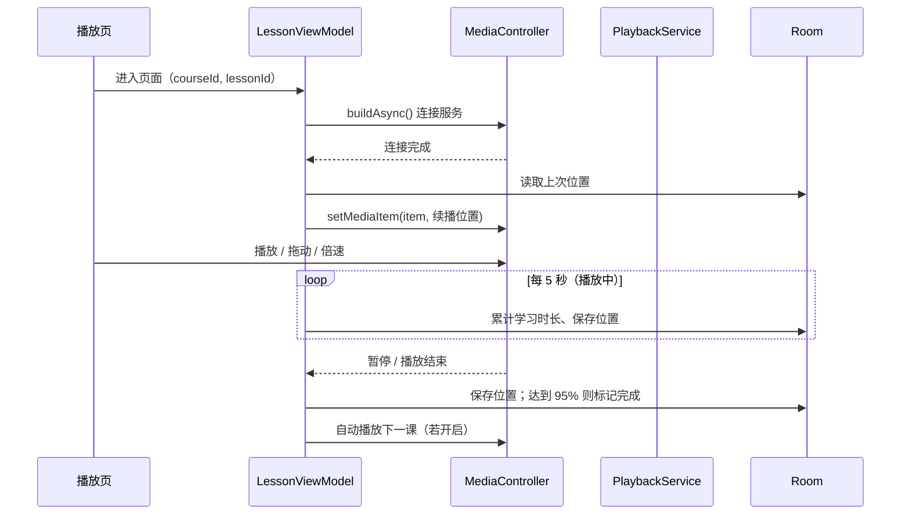

# 架构说明

本文档说明无限学堂的分层结构、数据模型与播放流程，便于贡献者快速理解代码。

## 分层

| 层 | 目录 | 职责 | 依赖 |
|----|------|------|------|
| 界面 | `ui/` | Compose 页面、导航、主题 | ViewModel |
| 视图模型 | `ui/**/XxxViewModel` | 组合数据流为界面状态，处理用户动作 | 仓库、播放控制器 |
| 仓库 | `data/repo/` | 对外提供数据操作（不暴露 DAO） | DAO、DataStore、assets |
| 持久化 | `data/db/`、`data/prefs/` | Room 表与 DAO；DataStore 偏好 | Android |
| 业务规则 | `domain/` | 完成判定、连续天数、成就条件 | **仅 Kotlin 标准库** |
| 播放 | `playback/` | `MediaSessionService` 持有 ExoPlayer | Media3 |
| 安全 | `data/security/` | 密码哈希 | JDK |
| 依赖注入 | `di/` | Hilt 模块、进程级协程作用域 | Hilt |

### 为什么业务规则要独立成 `domain/`

完成判定（95%）、连续天数（今天未学时从昨天起算）、成就条件这些规则会被多个页面使用，且最容易出错。把它们写成不依赖 Android 的纯函数，可以直接用 JUnit 测试，无需模拟器。对应的测试位于 `app/src/test/`。

## 数据模型（Room，version 2）

```
users ─┬─< progress >── lessons >── courses ──┬─< reviews
       ├─< notes    >── lessons              │
       ├─< achievements                      │
       ├─< study_days                        │
       ├─< favorites  >──────────────────────┤
       └─< purchases  >──────────────────────┘
```

| 表 | 主键 | 说明 |
|----|------|------|
| `users` | `id`（自增） | 本地账号，`username` 唯一 |
| `courses` | `id` | 课程目录，来自 `courses.json` |
| `lessons` | `id` | 课时，外键关联课程，删除课程级联删除 |
| `reviews` | `id`（自增） | 课程评论，来自 `courses.json` |
| `progress` | `(userId, lessonId)` | 播放位置与完成标记；完成后不会被改回未完成 |
| `notes` | `id`（自增） | 笔记，记录时间点 `positionMs` |
| `achievements` | `(userId, code)` | 已解锁成就，`code` 对应枚举名 |
| `study_days` | `(userId, day)` | 每日累计学习秒数 |
| `favorites` | `(userId, courseId)` | 收藏 |
| `purchases` | `(userId, courseId)` | 购买或免费领取记录 |

**目录与用户数据分离**：每次启动只替换 `courses`、`lessons`、`reviews`，用户数据表不受影响。课时 `id` 是进度与笔记的关联键，因此不要随意修改。

## 播放流程



- 播放器位于 `PlaybackService` 中，因此离开页面、切到其他应用或锁屏后仍可播放。
- 离开播放页时 ViewModel 会暂停播放，并在进程级作用域 `AppScope` 中保存最后位置，避免 ViewModel 被取消导致写入丢失。
- 全屏通过切换 `requestedOrientation` 与系统栏显示实现。清单中声明了 `configChanges`，旋转时 Activity 不会重建，播放不中断。

## 界面导航

- 未登录时进入 `auth`；登录后进入 `home`，退出后回到 `auth`。
- 底部导航四个标签：`home`、`category`、`learning`、`profile`。
- 其他页面（课程详情、播放、搜索、笔记、成就、占位页）为二级页面，不显示底部导航。
- 会话状态有三种：`Loading`（读取中，显示加载圈，避免误跳转）、`Guest`、`LoggedIn`。

## 测试策略

| 类型 | 覆盖 | 运行方式 |
|------|------|----------|
| 单元测试 | 完成判定、连续天数、成就、密码哈希 | `./gradlew testDebugUnitTest`（CI 自动运行） |
| 手动测试 | 播放器、全屏、后台播放、通知栏 | 需真机或模拟器，尚未自动化 |

后续可补充仪器测试（Compose UI Test）与 Room 迁移测试。
